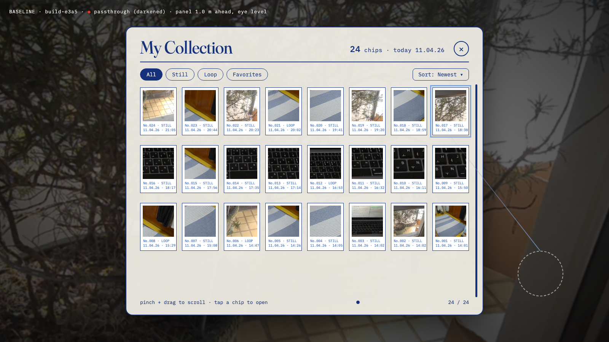

# 전시: 모은 컬러칩 디스플레이

---
**Claude Code** · 2026-11-04 · build-e3a5-analyze-823e

## 1. 연구: 칩 모음의 물리적 선례

전제: DECIDED 11-03 대로 컬러 차트 칩·즉석 사진은 **감각 레퍼런스만**. 아래 선례도 "형식이 하는 일"만 뽑았고, 특정 회사의 랙 배치·번호 체계·로고·이름은 가져오지 않는다.
칩 = 위 재료 + 아래 라벨 띠 (IL-00 §05), 라벨 = No.### · MM.DD.YY · HH:MM.

### 선례 표

| # | 선례 | 형태 | 하는 일 (기능) | MR 적합성 (Quest 3 패스스루, 손만, 앉아서 ≤60cm) |
|---|---|---|---|---|
| 1 | 도료 칩 랙 (매장 벽면 진열대) | 같은 크기 카드가 행·열 그리드, 색군 → 명도 순. 꽂혀 있고 뽑아 감 | 훑어보기 · 비교 · 고르기(뽑기) | 벽 평면 그리드라 MRUK 벽면 배치가 쉬움. 대신 칩 수가 늘면 FoV를 넘고, 벽은 60cm 밖이라 손으로 뽑기 어려움 (원거리 = 레이/응시) |
| 2 | 팬덱 (부채형 색견본) | 한 점 핀에 꿴 긴 스트립 묶음, 부채처럼 펼침 | 이웃 색 비교 · 휴대 · 한 번에 한 줄 집중 | 손 위·손바닥 크기라 60cm 안에 딱 맞음. 다만 왼손 위 포탈 휠(11-04)과 자리·은유가 겹침. 스트립 수가 늘면 펼침 각이 한계 |
| 3 | 색 체계 아틀라스 (색상환 축 책) | 페이지마다 한 색상, 세로 명도·가로 채도 격자 | 체계 안의 위치 = 의미 · 빈 자리로 "없는 색"이 보임 | 우리 칩은 체계가 아니라 채집순. `paint.json` 의 lightTone/midTone 으로 자동 정렬은 가능. 번호 체계는 따라 하지 않음(원리만) |
| 4 | 밀착 인화지 (contact sheet) | 한 롤의 프레임을 시간순 그리드로 한 장에, 프레임 번호, 그리스펜슬 표시 | 시간 순서 · 한눈에 개수 · 고르기(동그라미) | "하루 = 한 장"으로 끊으면 평면 1장 = 앵커 1개 · 메시 1개로 싸다. 즉석 사진 느낌과 결이 맞음 |
| 5 | 즉석사진 벽 (코르크보드·냉장고) | 흰 테두리 사진을 압정·자석으로 느슨하게, 아래 여백에 손글씨 | 기억 · 자랑 · 계속 덧붙이기 | 실제 벽·문·냉장고 표면에 붙이기 = 공간 앵커 패턴 그대로. 정렬 안 해도 되니 추가가 쉬움. 표면 하나에 수십 개 넘으면 겹침 |
| 6 | 곤충 표본 서랍 (유닛 트레이) | 캐비닛 → 서랍 → 작은 상자 → 핀 + 아래 작은 라벨 | 분류 · 대량 보관 · 꺼내서 비교. 보이는 건 열린 서랍 하나 | 서랍 = 자연스러운 페이지/숨김이라 성능에 유리(열린 서랍만 그림). 책상 위 60cm 안에서 "끌어당겨 열기" 가능 |
| 7 | 식물 표본 대지 (herbarium sheet) | 큰 대지 한 장에 표본 하나, 오른쪽 아래 라벨 (번호·날짜·장소·채집자) | 개체 하나의 기록 · 증거 | 상세 보기 1개 형식. 라벨 항목이 우리 재료 이름 규칙(번호·날짜·장소)과 거의 같음 |
| 8 | 활판 활자 케이스 (job case) | 칸 크기·위치가 쓰는 빈도대로인 나무 상자 | 손이 기억하는 빠른 꺼내기 | 손 닿는 칸 = 자주 바르는 물감. 60cm·손만에 맞음. 칸이 고정이라 늘어나는 수집과는 충돌 |
| 9 | 카드 카탈로그 서랍 | 깊이 방향으로 선 카드, 탭 구분, 앞뒤로 넘김 | 색인 · 대량 중 하나 찾기 | 깊이로 쌓아 FoV 를 작게 차지. 넘기는 손동작이 생김. 보이는 건 카드 윗변(라벨)뿐 |
| 10 | 진열장 선반 (분더카머) | 선반 위 서로 다른 오브제, 작은 라벨 카드 | 경이 · 자랑 · 수집가 정체성 | 데모 콘티 90~135초 "표본 선반"과 직결. 오브제마다 다른 물감 셰이더 = 오브제 수만큼 드로우콜 |
| 11 | 우표 스톡북 / 앨범 | 투명 띠 줄에 끼움, 앨범은 빈칸이 미리 인쇄 | 개수 · 완성 압박 (빈칸 채우기) | 빈칸 = 다시 올 이유. 다만 우리 채집엔 "세트"가 없어 빈칸 의미를 따로 만들어야 함 |
| 12 | 원단 스와치북 | 실물 천 조각 + 품번 라벨, 링 제본 | 만져 보기 · 재질 비교 | 촉감 없음 → 형식만. 재질 루프(LOOP 칩)가 "움직이는 견본"으로 대신할 여지 |

### 기능 축 정리 (선례 → 기능)
- **훑어보기·비교**: 1, 2, 3 · **시간 순서**: 4, 5 · **개수·자랑**: 5, 10, 11 · **꺼내기(물감 고르기)**: 2, 6, 8, 9 · **개체 기록**: 7
- 이 앱에서 전시가 해야 할 일 (task 목표): 채집욕 자극 + 다시 올 이유 → 주로 "개수·자랑"과 "시간 순서". "꺼내기"는 이미 포탈 휠이 맡음 (11-04)

## 2. MR 제약 표

| 축 | 수치 / 사실 | 칩 전시에 미치는 것 | 출처 |
|---|---|---|---|
| FoV · Quest 3 | 110°H × 96°V, 25 PPD (3S: 96°×90°, 20 PPD) | 넓음. 문제는 손 닿는 거리 쪽 | Meta Compare devices |
| FoV · Meta VR Glasses | 70°H × 66°V, 핵심 UI는 **권장 설계 영역 58°×54°** 안. 37 PPD | 전시가 한눈에 다 보여야 하면 58° 기준으로 잰다. 60cm 앞에서 가로 폭 = 2·0.6·tan29° ≈ **66cm**, 1m 앞 ≈ 1.1m | Meta Field of view |
| 손 닿는 거리 | 앉아서 핵심 조작 ≤60cm (공통 조건) | 60cm 안 = 책상 위·손바닥 위 크기. 벽 전시는 손이 안 닿음 → 응시/레이로만 | 공통 platform |
| 시선 목표 크기 | 응시 목표 ≥ **3.0°** = `2·d·tan(1.5°)` → 60cm 에서 3.1cm, 1m 5.2cm, 2m 10.5cm | 칩 한 장이 고를 대상이면 60cm 에서 ≥3.1cm. 2차원으로 빽빽하게 붙이면 응시 오차 (Meta: 2D 묶음 피하라) | Meta Eyes best practices |
| 라벨 글자 | 2D 패널 기준 최소 14px, 편한 읽기 18px+. 48dp ≈ 3° 이므로 14px ≈ 0.88°, 18px ≈ 1.13° | 글자 높이(em) 환산: 60cm 에서 **9mm / 12mm**, 1m 15mm / 20mm, 2m 31mm / 39mm. 4cm 칩 라벨 띠(약 1cm)에 3줄은 안 들어감 → 거리별 라벨 줄 수를 줄이거나 가까이서만 읽기 | Meta Typography + Eyes best practices (환산은 계산) |
| 글자 스타일 | 이탤릭 쓰지 말 것, 가는 굵기는 크기 키움, MR 에서 밝은 벽은 글자를 씻어냄 | Plex Mono Regular/Medium, Fraunces 이탤릭 없음(이미 DECIDED). 라벨 띠는 흰 바탕 + 남색 받침 유지 | Meta Typography |
| 공간 앵커 지속 | `OVRSpatialAnchor` Create → `SaveAnchorAsync` → 다음 세션 `LoadUnboundAnchorsAsync` → `LocalizeAsync` → `BindTo`. UUID 는 앱이 직접 저장(JSON 등). 매니페스트 `com.oculus.permission.USE_ANCHOR_API` | 전시 위치를 다음 날 그대로 = 앵커 UUID + 칩 목록 JSON 을 같이 저장. 칩 데이터(`paint.json`)와 위치(앵커)는 따로 산다 | Meta Spatial Anchors (2026-10-07) |
| 앵커 정확도 | 내용은 앵커 **3m 안**, 가까운 내용은 앵커 하나에 부모로 묶기. 앵커는 못 움직임(지우고 새로). 개수 상한 없음. 다른 방·층의 앵커가 로드될 수 있음 → 가장 가까운 것 사용, 다시 놓기 쉽게 | 전시 한 덩어리 = 앵커 1개 + 자식 칩들. 산책 중 다른 곳에서 열면 앵커 로컬라이즈 실패 가능 → "전시를 여기 다시 놓기"가 필요 | Meta Spatial Anchors Best Practices |
| 지속 없이 고정만 | MRUK World Locking = 앵커 직접 안 써도 월드 고정. 지속·공유엔 앵커 | 세션 안에서만 고정이면 MRUK 로 충분 | Meta Spatial Anchors (note) |
| 드로우콜 | 같은 셰이더·머티리얼 유지가 핵심 (머티리얼 교체 +64%, 셰이더 교체 +175%). 같은 물체 다시 그리기는 다른 물체의 약 25%. 아틀라스 권장. 텍스처 크기는 드로우콜 비용에 거의 영향 없음 | 칩 N개 = 같은 쿼드 + 같은 머티리얼 + 텍스처 배열 슬라이스 → GPU 인스턴싱 1~몇 콜. 칩마다 머티리얼이면 N콜 | Meta Draw Call Cost Analysis |
| 텍스처 메모리 (계산) | 지금 tile.png = 853² RGBA32 ≈ 2.9MB (밉 포함 ≈ 3.9MB). 기기에서 찍은 텍스처는 런타임 ASTC 압축이 어려움(가정, 실기 확인 필요) | 원본 그대로: 30개 ≈ 117MB · 100개 ≈ 390MB · 300개 ≈ 1.2GB → 불가. 전시용 썸네일 256²(밉 포함 ≈ 0.35MB): 30 ≈ 10MB · 100 ≈ 35MB · 300 ≈ 105MB. 128²: 300 ≈ 26MB. 원본은 바를 때만 로드 | 계산 (Quest 3 메모리 8GB: Compare devices) |
| 라벨 텍스트 비용 | TMP 라벨을 칩마다 두면 칩 수만큼 메시·콜 | 라벨을 썸네일에 구워 넣기(찍을 때 1회) 또는 전시 전체를 TMP 메시 하나로 | 공통 perf-rules (텍스트 = TMP) |
| LOOP 칩 | 루프 칩은 움직이는 텍스처 | 300개가 다 흐르면 비쌈 → 보이는 몇 개만 재생, 나머지는 첫 프레임 | 공통 perf-rules, 계산 |
| 합격선 | 60fps 유지, 5초 드롭 ≤3 (A3) | 칩 수 300 에서도 위 선을 지켜야 함 → 썸네일 + 인스턴싱 + 페이지(보이는 것만) | DECIDED 11-04 합격 기준 |

### 'Best Reason to Come Back' 각도
- 대회 트랙에 "Best Reason to Come Back" 이 따로 있음 (상금 단일 수상). 심사 기준 원문은 못 찾음 → 이름 그대로 "다시 열 이유"로만 해석
- 전시가 줄 수 있는 다시 올 이유 (형식에서 나온 것, 추천 아님): ① 개수가 날마다 늘어 보임(5, 11) ② 날짜별로 끊긴 시간 기록(4) ③ 그 자리에 그대로 있음 = 앵커 지속(5, 10) ④ 아직 빈 자리(3, 11)
- 제약: 산책 채집(11-04 사용 장면) → 채집은 밖, 전시는 집. 집 앵커가 다른 장소에서 안 잡히는 건 정상 동작으로 다뤄야 함

### 출처
- Meta · Compare devices (FoV, PPD, 메모리): https://developers.meta.com/vr/resources/compare-devices
- Meta · Meta VR Glasses field of view (70×66, 설계 영역 58×54): https://developers.meta.com/vr/essentials/field-of-view
- Meta · Eyes best practices (3° 목표, 2D 묶음 피하기): https://developers.meta.com/vr/design/eyes-best-practices
- Meta · Typography (14px 최소, 18px 편함, 이탤릭 금지): https://developers.meta.com/vr/design/styles_typography
- Meta · Spatial Anchors (save/load/localize/bind): https://developers.meta.com/vr/documentation/unity/unity-spatial-anchors-persist-content
- Meta · Spatial Anchors Best Practices (3m, 상한 없음, 다른 방): https://developers.meta.com/vr/documentation/unity/unity-spatial-anchors-best-practices
- Meta · MRUK scene data / world locking: https://developers.meta.com/vr/documentation/unity/unity-mr-utility-kit-manage-scene-data
- Meta · Draw Call Cost Analysis: https://developers.meta.com/vr/documentation/unity/po-draw-call-analysis
- Meta · Quest 메모리 블로그 (ASTC 블록 크기): https://developers.meta.com/vr/blog/getting-a-handle-on-meta-quest-memory-usage
- 대회 트랙 (Best Reason to Come Back): https://www.uploadvr.com/meta-launches-1-million-competition-for-hands-first-apps-ahead-of-vr-glasses/
- 도료 칩 진열: 진열대 특허(행·열 그리드) https://patents.google.com/patent/US9357859 · 색군별 매장 진열 기사 https://chainstoreage.com/news/picking-paint-now-snap-sherwin-williams
- 색 체계 아틀라스: https://www.britannica.com/print/article/397642 · https://munsell.com/color-blog/tag/munsell-book-of-color
- 밀착 인화지: https://clevelandart.org/exhibitions/proof-photography-era-contact-sheet
- 즉석 사진: https://en.wikipedia.org/wiki/Instant_camera
- 곤충 표본 서랍·유닛 트레이: https://www.southwestsolutions.com/divisions/museums/museum-storage-cabinets/entomology-storage-cabinets/ · https://collection.ento.vt.edu/?p=283
- 식물 표본 대지 라벨: https://herbariaunited.org/ahcontent/atHomeHowTo · https://sweetgum.nybg.org/science/wp-content/uploads/2019/03/Introduction_to_Herbarium_Specimen_Transcription.pdf
- 활자 케이스: https://en.wikipedia.org/wiki/California_job_case
- 카드 카탈로그: https://libraries.oberlin.edu/collections/special-collections/dewey-card-catalog/about-the-collection
- 진열장 선반: https://en.wikipedia.org/wiki/Cabinet_of_curiosities
- 우표 앨범·스톡북: https://en.wikipedia.org/wiki/Stamp_album · https://en.wikipedia.org/wiki/Stockbook
- 원단 스와치북: 출처 링크 못 찾음 (일반 지식, 형식만 참고)
- 확인 못 한 것: Quest 3 "드로우콜 몇 개까지" 같은 숫자 상한은 현재 Meta 문서에서 못 찾음 → 실기 perf 로 잼. 런타임 ASTC 압축 가능 여부도 실기 확인

---
**Claude Code** · 2026-11-04 05:57

analyze 끝: README §1 선례 12개(형태·기능·MR 적합성) + §2 MR 제약 14줄 + 출처 25링크. Meta 문서로 확인: 앵커 save/load/localize, 3m, 상한 없음 / 응시 3° / 글자 14·18px / VR Glasses 58×54 설계 영역. 남은 것: 드로우콜 숫자 상한·런타임 ASTC 는 문서에 없음 → 실기 perf

---
**Claude Code** · 2026-11-04 · build-e3a5-write-efba

## 3. 기준선 (베이스라인 차분 0단계)

측정용. 일부러 아무 창의도 안 넣은 "모은 칩 보기" 가장 뻔한 안. 버리는 시안이 아니라 아래 태깅 표의 기준.

- 파일: `assets/baseline-chip-wall.png` (1600×900, 원본 `assets/baseline-chip-wall.html`, 헤드리스 Chrome)
- 배경: 실제 패스스루 캡처 `catch-device/assets/paints/paint_20261104_140211_002/still.png` 를 어둡게
- 칩 재료: No.001~003 = 실제 채집 3장 그대로 (라벨도 실제 시간). No.004~024 = 같은 3장의 실제 캡처를 잘라 채운 것, 번호·시간은 더미
- 색·글자: B안 (선 `#F0EEE6`, 남색 `#15317C`, 코발트 `#2559B4` 라벨, 하늘 `#7FA6D9` 강조), Plex Mono + Fraunces 제목

**기준선 설명 (한 문단)**: 핀치로 "컬렉션"을 열면 눈높이 1m 앞에 평평한 사각 패널이 하나 뜬다. 위에 큰 제목 "My Collection" 과 총 개수, 오른쪽 위 닫기 ✕. 그 아래 필터 알약 탭(All / Still / Loop / Favorites)과 정렬 드롭다운(Newest). 본문은 같은 크기 칩이 8열 그리드로 최신순, 칩마다 흰 즉석 사진 테두리 + 아래 라벨 띠(No. · 모드 · 날짜 · 시간). 응시/레이가 닿은 칩은 하늘색 테두리로 강조, 핀치로 열면 크게 보기. 오른쪽에 스크롤바, 아래에 "pinch + drag to scroll" 안내와 페이지 점. 패널은 머리를 따라오지 않고 그 자리에 떠 있다(세션 안 월드 고정, 다음 세션엔 다시 앞에 뜸).

### 태깅 표

관객 예측 확신도 = 관객이 "칩 모음 보기"라는 말만 듣고 이걸 미리 떠올릴 확률. 상 = 거의 확실히 예측.

| # | 요소 | 관습 이름 | 그 관습의 기능 | 관객 예측 확신도 |
|---|---|---|---|---|
| 1 | 같은 크기 칩의 행·열 그리드 | 갤러리 그리드 (사진 앱·매장 칩 랙) | 한눈에 훑기, 개수 감 | 상 |
| 2 | 최신순 정렬, 왼쪽 위가 최신 | 피드 / 카메라 롤 순서 | 방금 찍은 걸 바로 찾기 | 상 |
| 3 | 공중에 뜬 평평한 사각 패널, 눈높이 1m | 플로팅 윈도우 (VR 2D 패널) | 어디서나 읽히는 화면, 배치 고민 없음 | 상 |
| 4 | 큰 제목 "My Collection" + 총 개수 | 앱 화면 헤더 / 컬렉션 카운터 | 지금 어디인지 + 얼마나 모았는지 자랑 | 상 |
| 5 | 흰 테두리 + 아래 라벨 띠 | 즉석 사진 프레임 / 칩 카드 (이미 IL-00 §05) | "찍어서 모은 물건" 신호, 라벨 자리 | 상 |
| 6 | 라벨 = 번호 · 날짜 · 시간 | 표본 라벨 / 인화지 프레임 번호 | 개체 구분, 시간 기록 | 중 |
| 7 | 오른쪽 위 닫기 ✕ | 윈도우 닫기 버튼 | 명시적으로 나가기 (Meta 가이드도 권장) | 상 |
| 8 | 필터 알약 탭 All / Still / Loop / Favorites | 세그먼트 필터 칩 | 종류별로 줄여 보기 | 중 |
| 9 | 정렬 드롭다운 "Newest ▾" | 정렬 메뉴 | 순서 바꾸기 | 중 |
| 10 | 응시/레이가 닿으면 테두리 강조 | 호버 하이라이트 | 지금 뭘 가리키는지 | 상 |
| 11 | 핀치로 열면 크게 보기 | 라이트박스 / 상세 보기 | 한 개 자세히 | 상 |
| 12 | 스크롤바 + 핀치 드래그 스크롤, 페이지 점 | 스크롤 리스트 / 페이지네이션 | 화면보다 많은 칩 담기 | 중 |
| 13 | 화면 안 사용 안내 문장 | 코치 마크 / 힌트 텍스트 | 조작 알려 주기 (A4 "설명 텍스트 없이"와 충돌) | 중 |
| 14 | 다음 세션엔 다시 정면에 뜸 (위치 기억 안 함) | 앱 창 다시 열기 | 구현 단순, 어디서나 열림 | 중 |
| 15 | 모든 칩이 같은 크기·같은 거리 | 균일 썸네일 | 공정한 비교, 성능(인스턴싱 1콜) | 상 |
| 16 | 패스스루는 그냥 배경 (방과 상관없는 위치) | 오버레이 UI | 방 상태와 무관하게 동작 | 중 |

### 측정 메모 (기준선이 MR 제약에 걸리는 곳, §2 수치 대비)
- 1m 패널 폭 940px 상당 ≈ 0.9m 가정 시 칩 한 장 ≈ 9cm ≈ 5.2° → 응시 3° 는 넘음. 라벨 9px 상당 글자 ≈ 0.5° 수준이라 14px(0.88°) 최소 아래 → 실기에선 라벨이 안 읽힐 가능성
- 1m 는 손 60cm 밖 → 칩 고르기는 레이/응시 전용. 300개면 페이지 13장
- 세션 사이 위치를 안 남기므로 앵커 0개 (가장 싼 쪽)

---
**Claude Code** · 2026-11-04 05:59

write 끝: README §3 기준선(눈높이 1m 플로팅 패널, 8열 최신순 그리드, 필터 탭·정렬·✕·스크롤) + 태깅 표 16줄(관습·기능·확신도) + assets/baseline-chip-wall.png. 칩 1~3 은 실제 채집, 나머지는 같은 캡처 크롭 + 더미 번호. 다음: decide-a2f7 (사람이 깰 지점 + 바깥 씨앗 고르기). 대안은 아직 안 만듦
