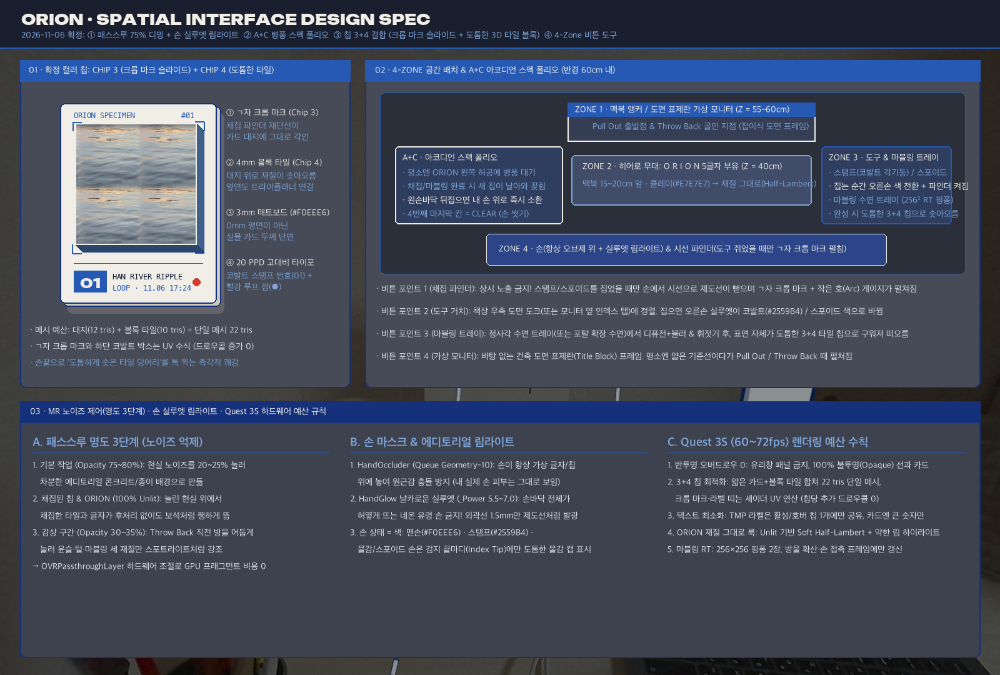
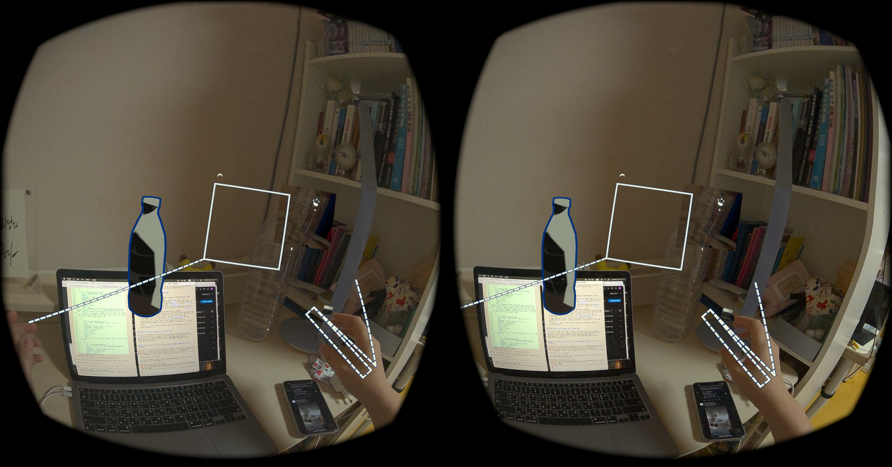
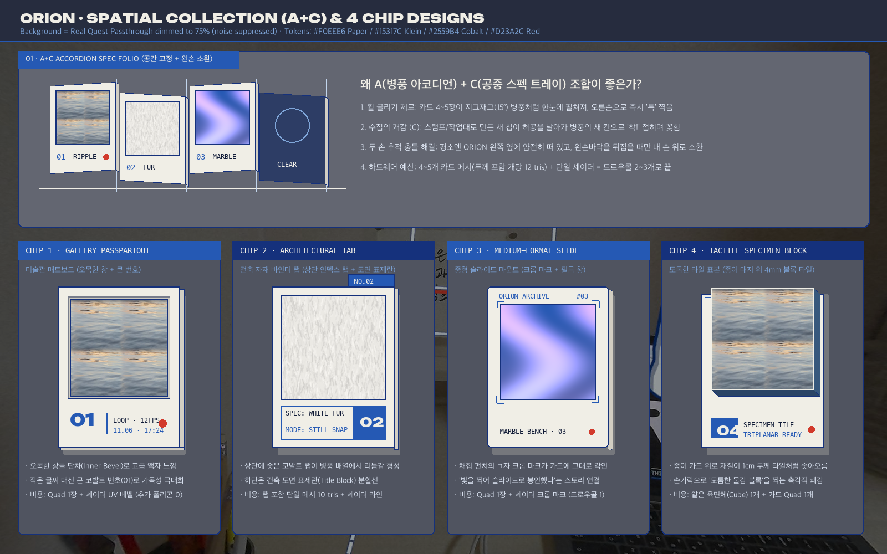
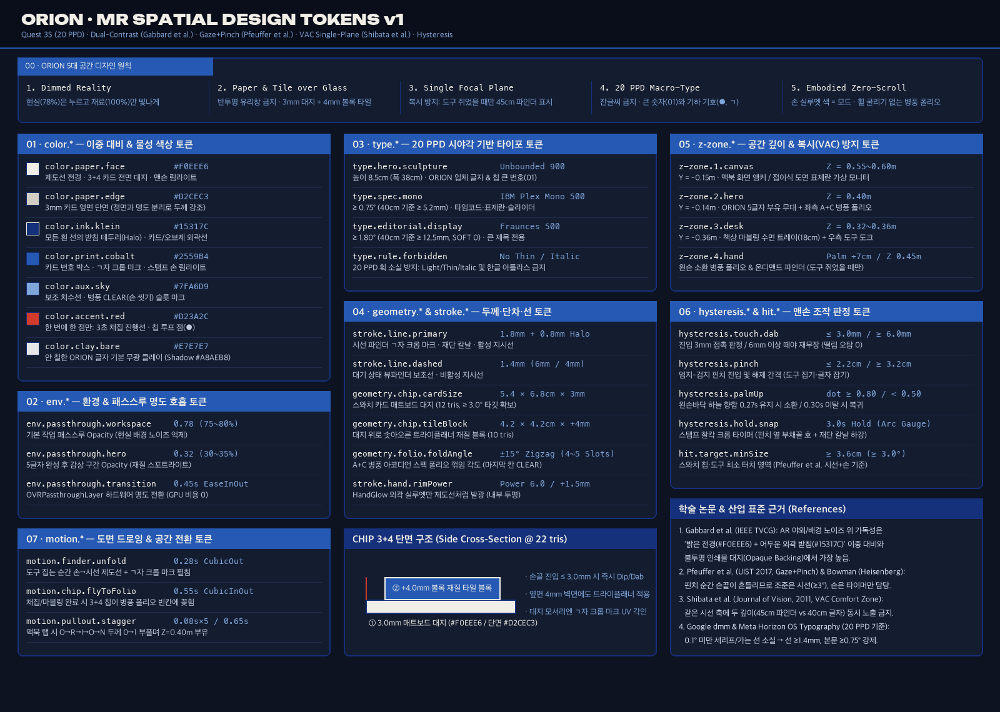
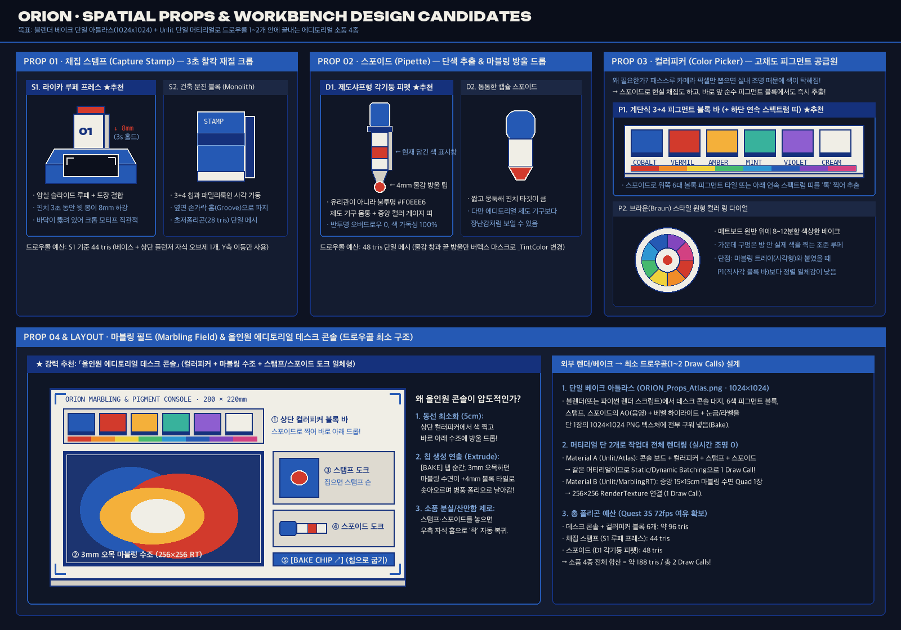
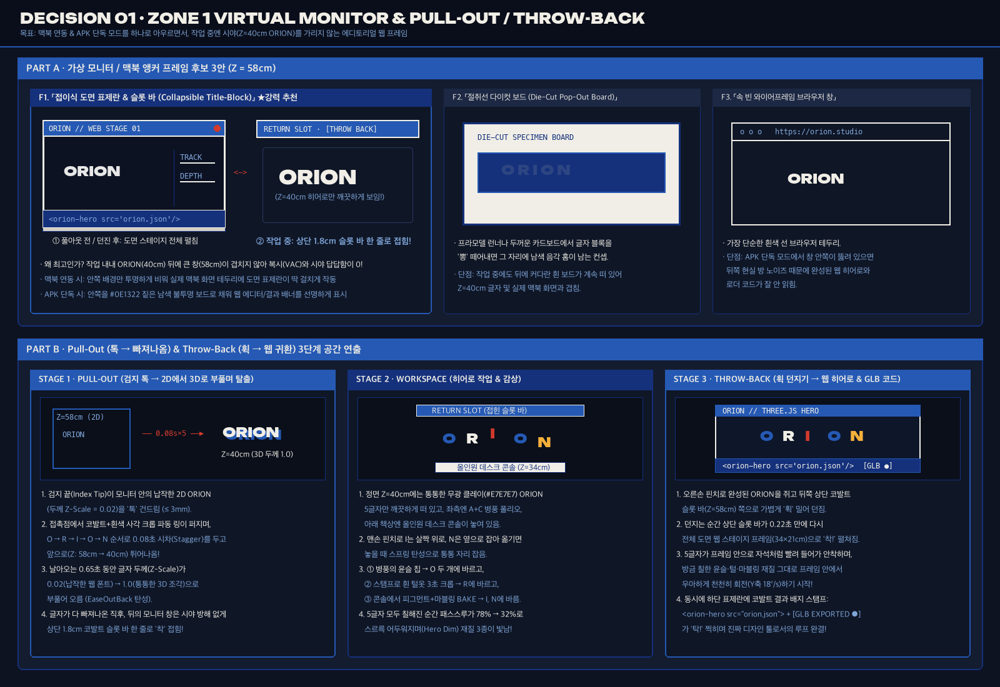
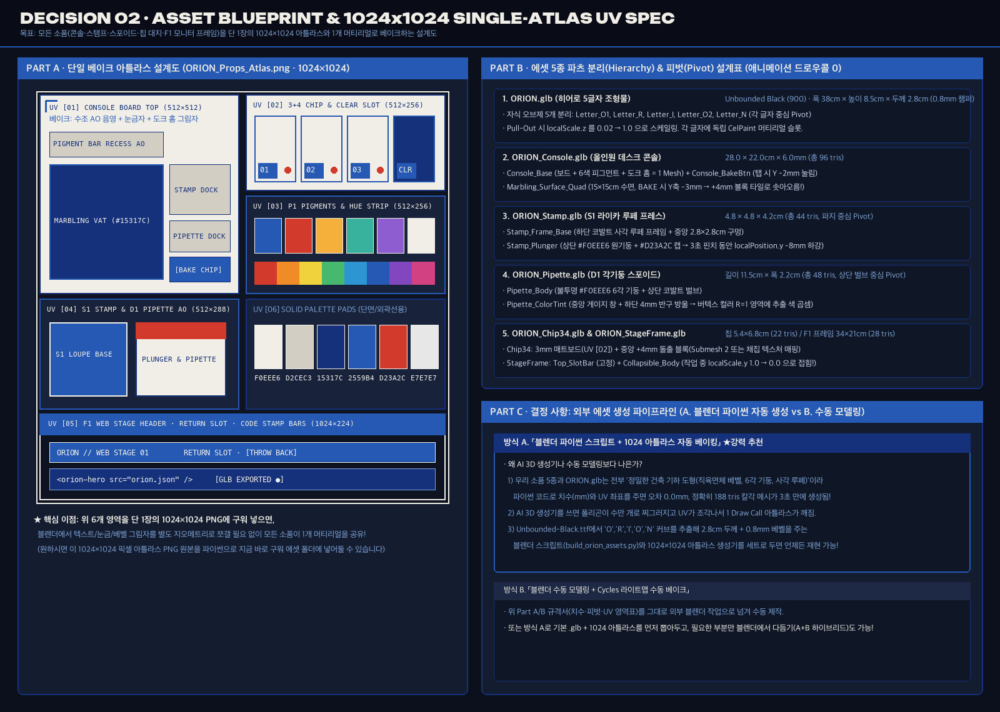
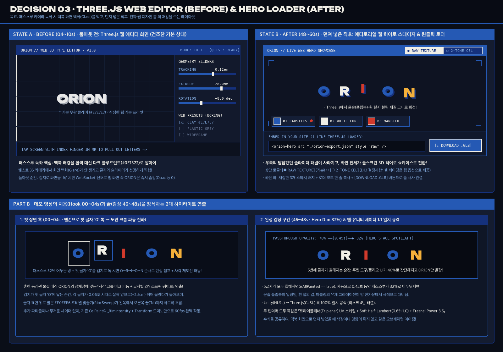

# 인터페이스 디자인 (ORION Spatial Interface Spec)

> **2026-11-06 확정 (사람 + Gemini Argon)**
> Quest 3S 실기 스켈레톤 캡처(`quest_shot_2.png`) 진단에서 출발하여, **MR 배경 노이즈 제어 · 손 림라이트 · A+C 병풍 아코디언 스펙 폴리오 · 3+4 결합 컬러 칩 · 4-Zone 공간 배치 · Quest 3S 하드웨어 예산**을 요소별로 확정한 공간 인터페이스 명세서다.

---

## 0. 실기기 스켈레톤 진단 (왜 기존 화면이 디버그 기즈모처럼 보였는가)

1. **현실(패스스루)의 모든 것이 시각적 노이즈로 작동**:
   - VR과 달리 MR 패스스루는 책장·모니터·벽지·전선 등 중간 톤의 고주파 노이즈가 화면 전체를 채운다. 패스스루가 100% 밝기일 때는 얇은 흰 선과 민무늬 `Quad` 칩이 배경에 그대로 묻힌다.
2. **선이 '건축 도면'이 아니라 '콜라이더 기즈모'로 읽힘**:
   - 오른손 위를 덮는 큰 점선 박스형 레버와, 채집하지 않을 때도 시선 정중앙을 상시 가로막는 굵은 사각형이 겹쳐 시야가 산만함.
3. **왼손 디스크 휠 굴리기의 조작 피로 & 컬렉션 감성 부재**:
   - 허공에 뜬 왼손 위 원형 휠을 오른손으로 쓸어 굴리는 동작은 조준이 어렵고, 작은 정사각 `Quad`들이 원형으로 겹쳐 있어 "소중한 수집품(Collection)"이라는 인상을 주지 못함.

---

## 1. 핵심 감각 & MR 노이즈 제어: 「에디토리얼 편집 데스크」

> **"내 방 책상이 건축·타이포그래피 매거진(`THE PLAN`, `SPACE`, `FORM & FUNCTION`)의 편집 데스크(Editorial Cutting Desk)가 된다."**

### 1-1. 패스스루 3단계 명도 호흡 (`OVRPassthroughLayer` 하드웨어 조절)
반투명 검은 쿼드로 화면을 덮지 않고(오버드로우 0), `OVRPassthroughLayer`의 `textureOpacity` / 밝기·대비 컬러맵으로 현실 노이즈를 제어한다.

| 단계 | 시점 | 패스스루 상태 | 시각적 효과 (노이즈 대비 히어로 분리) |
|---|---|---|---|
| **① 기본 작업 (Workspace)** | 앱 진입 후 평상시 (풀아웃, 채집, 바르기, 작업대) | **Opacity 75~80%** (밝기·채도 약 20~25% 톤다운) | 방 안의 생활 노이즈가 차분한 콘크리트/종이 배경처럼 가라앉고, `#F0EEE6` 제도선과 `ORION` 글자가 블룸 없이도 자체 발광하듯 선명하게 분리됨 |
| **② 채집된 칩 & ORION** | 스탬프 채집 직후 / 칩·글자 렌더링 | **가상 오브제는 100% Unlit 밝기** | 75%로 눌린 현실 위에서 방금 오려낸 스와치 타일과 `ORION` 재질만 100% 밝기로 빛나며 "현실보다 더 선명한 수집품"의 쾌감을 줌 |
| **③ 감상 구간 (Hero Dim)** | 5글자 모두 칠한 직후 감상 (Throw Back 직전) | **Opacity 30~35%** | 방이 어두운 무대처럼 가라앉고, 윤슬·털·마블링 세 가지 재질이 입혀진 `ORION`만 스포트라이트를 받은 듯 떠오름 |

### 1-2. 손 마스크 & 에디토리얼 실루엣 림라이트 (`build-be9a` 연결)
- **항상 가상 오브제 위 (`HandOccluder.shader`)**: `Queue = Geometry-10`, `ColorMask 0`, `ZWrite On`으로 내 실제 손이 `ORION` 글자나 칩보다 항상 위에 보이게 깊이만 기록한다.
- **날카로운 외곽선 림라이트 (`HandGlow.shader`)**:
  - 기존 기본값(`_Power 2.5`)처럼 손바닥 전체가 허옇게 뜨는 '네온 유령 손' 금지.
  - 프레넬 지수 **`_Power`를 `5.5 ~ 7.0`으로 날카롭게 조여**, 손 안쪽은 실제 피부가 그대로 보이고 **손 외곽 실루엣 1.5mm에만 제도선 잉크처럼 얇고 쨍한 림라이트**가 흐르게 한다.
- **손 상태 = 색 ([DECIDED D6~D8](../../../shared/DECIDED.md))**:
  - **맨손**: 흰 제도선 `#F0EEE6` 실루엣 림
  - **스탬프 손**: 코발트 `#2559B4` 실루엣 림
  - **물감 손 / 스포이드 손**: 손 전체를 칠하지 않고, **오른손 검지 끝마디(Index Tip)에만 해당 재질/색상이 맺힌 도톰한 물감 캡(구슬)**을 표시해 우아함과 모드 가독성을 동시에 확보한다.

---

## 2. 컬렉션 & 선택 인터페이스: 【A+C 병풍 아코디언 스펙 폴리오】

기존 '왼손 위 디스크 휠 굴리기'와 '어설픈 손바닥 구멍(Stencil) 포탈'을 폐기하고, **A(병풍 아코디언 폴리오, Leporello) + C(공중 스펙 트레이 도킹)** 결합 모델로 확정한다.

1. **형태 (병풍 아코디언 폴리오)**:
   - 4~5칸의 스와치 카드 슬롯이 **약 15°씩 지그재그(병풍 접지)로 꺾여 일렬로 서 있는** 입체 폴리오 구조.
   - 휠을 굴릴 필요 없이 오늘 쓰는 핵심 재료들(`01 윤슬`, `02 흰 털`, `03 마블링 그라데이션`)이 처음부터 눈앞에 큼직하게 펼쳐져 있다.
   - 마지막 칸(4번째 또는 끝 슬롯)은 짙은 남색 바탕에 하늘색 원이 그려진 **`CLEAR`(손 씻기) 전용 슬롯**으로 두어, 기존 가운데 우물 기능을 직관적으로 대체한다.
2. **평소 위치 (C · 공중 스펙 트레이 도킹)**:
   - 평소에는 왼손을 들고 있을 필요 없이, **`ORION` 글자 왼쪽 허공(Z ≈ 40cm)에 에디토리얼 스펙 보드처럼 얌전히 떠 있다.**
   - 스탬프로 털옷을 채집하거나 마블링 작업대에서 그라데이션을 완성하면, 새로 구워진 칩이 허공을 날아가 **병풍 폴리오의 빈 슬롯에 '착!' 하고 꽂히며 컬렉션이 채워진다.**
   - 오른손 검지로 병풍에 꽂힌 칩을 그냥 **'톡' 건드리면(Dip)** 바로 손끝에 물감이 묻고, 바로 옆 `ORION` 글자에 가져다 대어 바른다 (두 손 겹침으로 인한 손 추적 흔들림 원천 차단).
3. **왼손 소환 (A · 손바닥 포탈 호출)**:
   - 작업 중 언제든 **왼손바닥을 하늘로 뒤집으면**, 공중에 있던 병풍 아코디언 폴리오가 내 **왼손바닥 위 7cm로 스르륵 날아와(또는 펼쳐져)** 앉은 자리 어디서든 바로 찍거나 씻을 수 있다.

---

## 3. 확정 컬러 칩 디자인: 【CHIP 3 (크롭 마크 슬라이드) + CHIP 4 (도톰한 3D 타일 블록)】

단순 0mm 평면 `Quad`가 아니라, **"채집 파인더의 크롭 마크가 각인된 스펙 카드 대지 위로, 4mm 두께의 재질 타일 블록이 도톰하게 솟아오른"** 결합 디자인으로 확정한다.

| 구성 층 | 시각·물성 디테일 | 색·타이포 토큰 | 하드웨어 예산 (Quest 3S) |
|---|---|---|---|
| **① 카드 대지 (Slide Mount)** | **3mm 두께**의 빳빳한 매트보드 대지. 0mm 평면이 아니라 병풍으로 꺾였을 때 밝은 종이 단면(`#D2CEC3`)과 남색 외곽선(`#15317C`)이 보임 | 전면 `#F0EEE6` / 단면 `#D2CEC3` / 엣지 `#15317C` | 얇은 육면체(12 tris) |
| **② 모서리 ㄱ자 크롭 마크 (Chip 3)** | 재질 타일 네 모서리 바깥 대지 위에 채집 파인더와 동일한 **`ㄱ`자 재단선(Crop Marks)**과 상단 마이크로 헤더(`ORION SPECIMEN #01`) 각인 | 코발트 `#2559B4` | 대지 UV 셰이더 수식 (추가 드로우콜 0) |
| **③ 4mm 볼록 타일 블록 (Chip 4)** | 대지 위로 **정사각 재질 블록이 4mm 도톰하게 튀어나와(Extruded) 얹혀 있음**. 타일의 윗면뿐 아니라 4mm 옆면 단면까지 트라이플래너로 윤슬·털·마블링 재질이 이어져 보임 | 채집 원본 텍스처 (`still.png` / `tile.png` / 루프 시트) | 얕은 육면체(전면+옆면 4개 = 10 tris). 대지와 합쳐 **칩 1개당 총 22 tris** |
| **④ 하단 고대비 라벨 띠** | Quest 3S(20 PPD)에서 깨지는 잔글씨 대신, 좌측에 **코발트 사각 스탬프 박스와 큼직한 번호(`01`, `02`, `03`)**, 우측에 루프/최신 표시용 **빨간 점(`●`, `#D23A2C`)** | 번호 `Unbounded Black` / 보조 `IBM Plex Mono` | 숫자는 셰이더/아틀라스 처리, 상세 TMP는 호버/선택 슬롯 1개만 공유 |

---

## 4. 4-Zone 공간 배치 & 요소별 비튼 디자인 (반경 60cm 내)

앉은 자세 반경 60cm 안에서 모든 인터랙션이 깊이(Z)와 좌우(X) 충돌 없이 이루어지도록 4개 구역으로 분리하고, 기존 스켈레톤의 평균적인 기즈모를 에디토리얼 모티브로 비튼다.

| 구역 / 요소 | 공간 위치 (몸 기준) | 확정 모티브 (비튼 디자인) | 연결 구현 카드 |
|---|---|---|---|
| **Zone 1 · 맥북 앵커 & 단독 모드 가상 모니터** | 정면 **55~60cm**, 눈 아래 15cm | **접이식 건축 도면 표제란(Title Block) 프레임**: 검은 브라우저 창 대신 바탕 없이 얇은 `#F0EEE6` 제도선 테두리 + 상단 코발트(`#2559B4`) 타이틀 바. 평소엔 얇은 기준선 한 줄이다가 Pull Out / Throw Back 때 도면 프레임이 펼쳐짐 | `build-7c8f`, `build-1b00`, `build-73cd` |
| **Zone 2 · `ORION` 5글자 히어로 무대** | 정면 **38~42cm**, 눈 아래 12~15cm | 맥북 화면보다 **15~20cm 앞 허공**에 부유. 안 칠한 상태는 블렌더 기본 무광 클레이(`#E7E7E7`), 칠한 후엔 광원 없이도 부드러운 입체감이 나는 **Soft Half-Lambert + 미세 프레넬 림(재질 그대로 룩)** | `build-402f`, `build-3e76`, `build-e463` |
| **Zone 3 · 책상 도구 도크 & 마블링 트레이** | 책상 면 또는 모니터 옆 (**앞 30~38cm**) | **· 도구 2종(스탬프·스포이드)**: 책상 우측 도면 도크(또는 모니터 옆 자석 인덱스 탭)에 놓인 무광 기하 블록(코발트 사각 기둥 스탬프 / 흰 원통 스포이드). **· 마블링 수면 트레이**: 정사각 에디토리얼 프레임(또는 왼손 포탈 확장 수면). 스포이드 방울 확산(디퓨전+블러)과 손 휘젓기 후, 수면 자체가 **도톰한 3+4 타일 칩으로 솟아올라** 병풍 폴리오로 날아가 꽂힘 | `build-8a30`, `build-5e10` |
| **Zone 4 · 온디맨드(On-Demand) 채집 파인더** | 시선 정면 **45cm** | **상시 노출 금지!** 맨손·물감 손일 때는 시야 중앙을 100% 비워 둔다. **스탬프/스포이드를 집었을 때만** 손에서 시선으로 얇은 제도선이 뻗어 나가며 **모서리 `ㄱ`자 크롭 마크 파인더**가 '착' 펼쳐지고, 손등의 거대한 박스 레버 대신 핀치 옆 **작은 부채꼴(Arc) 게이지 + 재단 칼날 하강**으로 3초 타이머를 표시한다 | `build-8a30`, `build-be9a` |

---

## 5. Quest 3S 하드웨어 예산(60~72fps) 수칙 요약

1. **반투명(Alpha Blend) 오버드로우 제로**: 배경 유리창 패널을 일절 쓰지 않고, 모든 선(`PunchCueView`), 프레임, 3+4 스와치 카드를 **100% 불투명(Opaque) Unlit**으로 렌더링한다.
2. **칩 1개 = 22 삼각형 단일 메시 + 단일 머티리얼**: 3mm 카드 대지(12 tris)와 4mm 볼록 타일(10 tris)을 하나의 메시로 묶고(서브메시 또는 버텍스 컬러/UV2 구분), 크롭 마크와 라벨 띠는 셰이더 UV 연산으로 처리해 드로우콜을 아낀다.
3. **`ORION` "재질 그대로 룩" (`build-3e76`)**: 실시간 라이트/그림자 없이, `CelPaint.shader`에 `dot(N, lightDir) * 0.5 + 0.5` 기반의 부드러운 음영(Soft Ramp)과 약한 프레넬 림만 더해 무광 클레이(`#E7E7E7`), 흰 털, 마블링 그라데이션, 윤슬 플립북의 계조가 뭉개지지 않게 한다.
4. **마블링 `RenderTexture` 예산 (`build-5e10`)**: `256×256` RGBA32 Bilinear RT 2장 핑퐁만 사용하며, 방울 확산 중이거나 손끝이 수면에 닿아 있는 프레임에만 Blit을 수행한다.

---

## 6. MR 공간 인터페이스 학술·산업 레퍼런스 5선

2D 웹/모바일 토큰(`px`, `rem`, 유리 블러)과 달리, 패스스루 MR 토큰은 **시야각(`deg`/`dmm`) · 배경 노이즈 대비(Dual-Contrast) · 깊이 초점(VAC) · 맨손 추적 히스테리시스(Hysteresis)**를 중심으로 설계해야 한다. 본 명세는 아래 5가지 학술 연구 및 산업 표준에 근거한다.

| # | 논문 / 산업 표준 | 핵심 발견 (Why it matters in MR) | ORION 토큰에의 직접 반영 |
|---|---|---|---|
| **1** | **Gabbard, Swan et al.** (*IEEE TVCG*, 2006–2014) *Text Drawing Styles & Outdoor/Passthrough AR Background Noise* | 예측 불가능한 현실 배경(책장·벽·모니터 등 중간 톤 고주파 노이즈) 위에서는 반투명 유리창보다 **① 밝은 전경 + 어두운 외곽 받침(`Billboarded Halo`)의 이중 대비(Dual-Contrast)**와 **② 불투명 인쇄물 대지(`Opaque Backing Strip`)**가 압도적으로 높은 판독 속도를 보임 | · 모든 `#F0EEE6` 제도선/크롭 마크 뒤에 `#15317C` 남색 받침 테두리 결합 · 반투명 유리창 금지, 칩을 불투명 3mm 매트보드 대지(`#F0EEE6`)로 설계 |
| **2** | **Pfeuffer, Mayer, Gellersen et al.** (*ACM UIST 2017*) *Gaze + Pinch Interaction in XR* & **Bowman et al.** (*Heisenberg Effect*) | 맨손 추적에서 엄지-검지를 맞대는 순간 손끝 위치가 미세하게 튀는 **하이젠베르크 효과(Heisenberg Effect of Spatial Interaction)**가 발생함. 따라서 **조준(어디를)은 시선(≥ 2.5~3.0°)**이 맡고, **손(언제)은 확정 트리거만** 맡아야 함 | · `Zone 4` 채집 파인더를 손 위치가 아닌 시선 정면(45cm)에 고정 · 손등의 큰 박스 레버를 폐기하고 핀치 옆 부채꼴(Arc) 타이머 + 재단 칼날 하강으로 분리 |
| **3** | **Shibata, Kim, Hoffman, Banks** (*Journal of Vision*, 2011) *The Zone of Comfort: Vergence-Accommodation Conflict (VAC)* | 같은 시선 축(Line of Sight) 위에 서로 다른 깊이(예: 45cm 파인더와 40cm `ORION` 글자, 또는 30cm 손과 60cm 모니터)의 UI가 동시에 겹치면 양안 복시(Double Vision)와 눈 피로가 급증함 | · **단일 초점면 상호배타 노출**: 맨손·물감 손일 땐 시선 파인더를 100% 숨기고, 스탬프/스포이드를 집었을 때만 파인더를 펼침 |
| **4** | **Google Spatial `dmm` Standard & Meta Horizon OS Typography** (*Quest 3S ≈ 20 PPD*) | 거리 무관 각도 단위(`1 dmm = 1m 거리에서 1mm ≈ 0.0573°`)로 크기를 정의해야 하며, 20 PPD 해상도에서는 `0.1°` 미만의 세리프 갈고리·이탤릭·얇은 획이 픽셀 사이로 소실(Shimmering)됨 | · `Thin`/`Light`/`Italic` 금지, 모든 선 최소 두께 `≥ 1.4mm` 강제 · 칩 카드에는 잔글씨 대신 `Unbounded 900` 큰 번호(`01`)와 기하 기호(`●`, `ㄱ`)만 상시 각인 |
| **5** | **Apple visionOS HIG & Meta Direct Touch Hysteresis** | 물리 버튼의 클릭 저항이 없는 허공에서는 **진입 임계값(Enter)**과 **이탈 임계값(Exit)**을 분리(Hysteresis)하지 않으면 손 떨림으로 인해 채집·물감 찍기가 연타로 오작동함 | · 모든 손 인터랙션(Dab 3mm/6mm, Pinch 2.2cm/3.2cm, Palm-Up 0.80/0.50)에 이중 임계값 토큰 부여 |

---

## 7. ORION 5대 공간 디자인 원칙 (Design Principles)

1. **Dimmed Reality, Vivid Specimen (현실은 누르고 재료만 빛나게)**
   - 현실 방을 이기려 애쓰지 않고 패스스루를 기본 `78%`로 차분히 가라앉힌 뒤, 내가 채집한 스와치 칩과 `ORION` 글자만 `100% Unlit` 밝기로 떠 있게 한다.
2. **Paper & Tile over Glass (유리창 대신 종이 대지와 볼록 타일)**
   - 흔한 XR의 반투명 홀로그램 유리창을 일절 쓰지 않는다. 모든 인터페이스는 **3mm 두께의 매트보드 대지(`#F0EEE6`)**와 **4mm 도톰하게 솟아오른 재질 블록**, **1.8mm 제도선**으로만 구성한다.
3. **Single Focal Plane at a Time (복시 방지를 위한 단일 초점면)**
   - 같은 시선 축에 두 개의 깊이를 동시에 띄우지 않는다. 맨손·물감 손일 때는 `ORION`(40cm)만 보이고, 스탬프·스포이드를 쥐었을 때만 시선 파인더(45cm)가 펼쳐진다.
4. **20 PPD Macro-Typography (잔글씨 대신 기호와 큰 번호)**
   - 스와치 칩과 도구 위에는 긴 설명문 대신 **굵은 두 자리 번호(`01`, `02`, `03`)와 기하 기호(`●`, `ㄱ` 크롭 마크)**만 상시 표시한다.
5. **Embodied Zero-Scroll (손 자체가 상태표시등, 휠 굴리기 제로)**
   - 별도 HUD 아이콘 없이 **내 손 외곽 1.5mm 실루엣 림라이트 색 + 검지 끝 물감 캡**만으로 현재 모드를 읽고, 휠을 굴리는 대신 **4~5칸 병풍 아코디언 폴리오**에서 한 번에 콕 찍어 쓴다.

---

## 8. ORION MR 디자인 토큰 체계 (7개 카테고리 확정표)

### 8-1. `color.*` — 이중 대비(Dual-Contrast) & 물성 색상 토큰

| 토큰 이름 | 값 (Hex) | 역할 및 MR 대비 규칙 |
|---|---|---|
| `color.paper.face` | `#F0EEE6` | 제도선 전경, 3+4 스와치 카드 전면 대지, 맨손 실루엣 림라이트 (차갑지 않은 도면 용지 백색) |
| `color.paper.edge` | `#D2CEC3` | 3mm 스와치 카드의 옆면 단면 색 (전면 `#F0EEE6`와 명도 차이를 주어 병풍이 꺾일 때 3mm 두께감이 즉시 읽히게 함) |
| `color.ink.klein` | `#15317C` | 모든 `#F0EEE6` 선의 **외곽 받침 테두리(Halo)**, 카드/오브제 윤곽선, 병풍 `CLEAR` 슬롯 바탕 |
| `color.print.cobalt` | `#2559B4` | 스와치 카드 번호 스탬프 박스, 모서리 `ㄱ`자 크롭 마크, 도면 표제란 헤더, **스탬프 손 림라이트** |
| `color.aux.sky` | `#7FA6D9` | 비활성 보조선, 치수 눈금, 병풍 `CLEAR`(손 씻기) 슬롯의 원형 마크 |
| `color.accent.red` | `#D23A2C` | **한 번에 한 곳에만 켜짐**: 3초 스탬프 채집 진행 아크/칼날, 또는 칩 우측 하단 루프 점(`●`) |
| `color.clay.bare` | `#E7E7E7` | 아직 칠하지 않은 `ORION` 글자의 블렌더 기본 무광 클레이 (Half-Lambert 음영 하한 `#A8AEB8`) |

### 8-2. `env.*` — 환경 & 패스스루 명도 호흡 토큰

| 토큰 이름 | 값 | 설명 |
|---|---|---|
| `env.passthrough.workspace` | `0.78` (`75~80%`) | 평상시 작업 중 패스스루 Opacity (`OVRPassthroughLayer` 하드웨어 조절, 오버드로우 0) |
| `env.passthrough.hero` | `0.32` (`30~35%`) | 5글자 모두 칠한 직후 감상 구간(Throw Back 직전) 패스스루 Opacity |
| `env.passthrough.transition` | `0.45s EaseInOut` | 작업 ↔ 감상 구간 전환 시 패스스루 명도 페이드 시간 |

### 8-3. `type.*` — Quest 3S (20 PPD) 시야각 기반 타이포그래피 토큰

| 토큰 이름 | 서체 / 웨이트 | 최소 시야각 (`deg`) | 40cm 기준 물리 크기 | 용도 및 제약 |
|---|---|---|---|---|
| `type.hero.sculpture` | `Unbounded` **900 (Black)** | `≈ 12.0°` | 높이 **`8.5cm`** (5글자 폭 `38cm`) | `ORION` 3D 입체 조형물 & 스와치 카드 좌하단 큰 번호(`01`, `02`, `03`) |
| `type.spec.mono` | `IBM Plex Mono` **500 (Medium)** | **`≥ 0.75°`** | **`≥ 5.2mm`** (`5.2 dmm`) | 표제란 헤더(`ORION SPECIMEN`), 슬라이더 수치 (`Light`/`Regular` 사용 금지) |
| `type.editorial.display` | `Fraunces` **500~600** (`SOFT 0, WONK 0`) | **`≥ 1.80°`** | **`≥ 12.5mm`** | 큰 섹션 타이틀 전용 (`1.5°` 미만 본문·라벨에는 세리프 절대 금지) |
| `type.rule.forbidden` | — | `< 0.65°` 금지 | `< 4.5mm` 금지 | `Thin`, `Light`, `Italic` 웨이트 금지 · 앱 내부 한글 폰트 아틀라스 포함 금지 (영문 대문자 + 숫자 + 기호만 사용) |

### 8-4. `geometry.*` & `stroke.*` — 물리 두께·단차·선 토큰

| 토큰 이름 | 물리 치수 | 설명 및 폴리곤 예산 |
|---|---|---|
| `stroke.line.primary` | **`1.8mm`** (`+ 0.8mm` `#15317C` 받침) | 시선 파인더 `ㄱ`자 크롭 마크, 재단 칼날, 활성 지시선 (20 PPD에서 끊기지 않는 최소 실선 두께) |
| `stroke.line.dashed` | **`1.4mm`** (선 `6mm` / 공백 `4mm`) | 대기 보조선 및 비활성 가이드라인 |
| `geometry.chip.cardSize` | **`5.4cm × 6.8cm × 3.0mm`** | 스와치 카드 매트보드 대지 (12 tris, 40cm 거리에서 시야각 `7.7° × 9.7°`로 시선+손 타깃 기준 충족) |
| `geometry.chip.tileBlock` | **`4.2cm × 4.2cm × +4.0mm`** | 대지 위로 4mm 돌출된 정사각 재질 타일 블록 (10 tris, 옆면 4mm 벽면까지 트라이플래너 텍스처 연장) |
| `geometry.folio.foldAngle` | **`±15°`** 지그재그 (4~5칸, 칸 간격 `2mm`) | A+C 병풍 아코디언 스펙 폴리오 접지 각도 (마지막 칸은 `CLEAR` 손 씻기 슬롯) |
| `stroke.hand.rimPower` | `_Power = 6.0` / `_Inflate = 1.5mm` | `HandGlow.shader` 프레넬 지수 (손 내부는 투명, 외곽 1.5mm 실루엣만 발광) |

### 8-5. `z-zone.*` — 공간 깊이 & 복시(VAC) 방지 토큰

| 토큰 이름 | 깊이 (`Z`, 눈 기준) | 높이 (`Y`, 눈 기준) | 배치 요소 및 복시(VAC) 방지 수칙 |
|---|---|---|---|
| `z-zone.1.canvas` | **`0.55 ~ 0.60m`** | `-0.15m` | 맥북 화면 앵커 & 단독 모드 접이식 도면 표제란 프레임 |
| `z-zone.2.hero` | **`0.40m`** | `-0.14m` | **`ORION` 5글자 히어로 무대** + 좌측(`X = -0.26m`) **A+C 병풍 아코디언 폴리오 도킹** |
| `z-zone.3.desk` | **`0.32 ~ 0.36m`** | `-0.36m` (책상 면) | **올인원 에디토리얼 데스크 콘솔 (`28 × 22cm × 6mm`)**: 상단 피그먼트 바 + 좌측 `15 × 15cm` 오목 마블링 수조 + 우측 스탬프·스포이드 자석 도크 |
| `z-zone.4.hand` | **왼손 위 `+7cm`** / 파인더 **`0.45m`** | 손 높이 / 시선 정면 | 왼손 소환 병풍 폴리오 & 온디맨드 시선 파인더 (**도구를 쥐었을 때만 표시하여 `z-zone.2`와의 복시 충돌 차단**) |

### 8-6. `hysteresis.*` & `hit.*` — 맨손 조작 판정 토큰

| 토큰 이름 | 진입 (Enter) | 이탈 (Exit) | 유지 시간 / 목적 |
|---|---|---|---|
| `hysteresis.touch.dab` | 표면 거리 **`≤ 3.0mm`** | 표면 거리 **`≥ 6.0mm`** | 스와치 칩 찍기(Dip) 및 `ORION` 글자 바르기(Dab) — 6mm 이상 떼야 다음 터치 재무장 |
| `hysteresis.pinch` | 엄지-검지 **`≤ 2.2cm`** | 엄지-검지 **`≥ 3.2cm`** | 도구 집기, 슬라이더 조절, 완성된 `ORION` 잡기 |
| `hysteresis.palmUp` | `dot(palmNormal, Up) ≥ 0.80` | `dot < 0.50` | **`0.27s` 유지 시** 병풍 폴리오를 왼손 위로 소환 / **`0.30s` 이탈 시** `ORION` 옆 공중 트레이로 복귀 |
| `hysteresis.hold.snap` | 핀치 진입 | 핀치 해제 | **`3.0s` 유지 시** 스탬프 찰칵 크롭 완료 (핀치 옆 부채꼴 Arc 게이지 + 재단 칼날 하강) |
| `hit.target.minSize` | **`≥ 3.6cm × 3.6cm`** (`≥ 3.0°`) | — | 모든 스와치 칩·도구·슬롯의 최소 물리 히트박스 크기 |

### 8-7. `motion.*` — 도면 드로잉 & 공간 전환 모션 토큰

| 토큰 이름 | 시간 / 이징 | 연출 디테일 |
|---|---|---|
| `motion.finder.unfold` | `0.28s` / `CubicOut` | 스탬프·스포이드를 집는 순간 손에서 시선으로 제도선이 뻗으며 `ㄱ`자 크롭 마크가 펼쳐짐 |
| `motion.chip.flyToFolio` | `0.55s` / `CubicInOut` | 채집 완료 또는 마블링 수면 굳히기 직후, 도톰한 3+4 칩이 포물선을 그리며 병풍 폴리오 빈 슬롯에 꽂힘 |
| `motion.pullout.stagger` | 글자당 `0.08s` 시차 / `0.65s` | 맥북 화면 탭 시 `O→R→I→O→N`이 `Z = 0.58m → 0.40m`로 튀어나오며 두께 스케일 `0 → 1`로 부풀어 오름 |

---

## 9. 소품 4종 & 올인원 에디토리얼 데스크 콘솔 확정 명세 (2-Draw-Call 베이크 규격)

> **2026-11-06 확정**: 채집 스탬프(`S1 라이카 루페 프레스`) · 스포이드(`D1 제도샤프형 각기둥 피펫`) · 컬러피커(`P1 계단식 3+4 피그먼트 블록 바 + 스펙트럼 띠`) · 마블링 필드(`올인원 에디토리얼 데스크 콘솔 일체형 트레이`)로 확정한다.

### 9-1. 확정 소품 4종 조형 & 인터랙션 기믹

| 소품 | 확정 디자인 | 물리 치수 / 폴리곤 예산 | 핵심 조형 디테일 및 작동 기믹 |
|---|---|---|---|
| **① 채집 스탬프 (Capture Stamp)** | **S1 · 라이카 루페 프레스 (Leica Loupe Press)** | 베이스 `4.8 × 4.8 × 1.4cm` + 상단 플런저 봉 `Ø 2.2 × 2.8cm` (**44 tris**) | · 암실 슬라이드 검수 루페 + 스탬프 프레스 결합형. · 하단 정사각 코발트(`#2559B4`) 프레임 중앙이 네모낳게 뚫려 있고 네 모서리에 흰색(`#F0EEE6`) `ㄱ`자 크롭 마크가 각인됨. · **3초 찰칵 기믹**: 핀치 3초 유지 동안 상단 오프화이트 플런저(윗면 빨간 캡 `#D23A2C`)가 로컬 Y축으로 **`-8mm` 하강**하며 베이스에 철컥 닿음 (추가 드로우콜 0). |
| **② 스포이드 (Pipette / Dropper)** | **D1 · 제도샤프형 각기둥 피펫 (Hex/Tri-Barrel Drafting Pipette)** | 길이 `11.5cm × 폭 2.2cm` (**48 tris**) | · 반투명 유리관 대신 **불투명 `#F0EEE6` 6각 제도 기구 배럴 + 상단 코발트(`#2559B4`) 고무 벌브**. · 배럴 정중앙의 **컬러 게이지 창(Color Window Band)**과 하단 노즐 끝 **`4mm` 반구형 물감 방울 팁**에 현재 추출한 색(`_TintColor`)이 100% Unlit으로 즉시 표시됨. |
| **③ 컬러피커 (Color Picker)** | **P1 · 계단식 `3+4` 피그먼트 블록 바 + 하단 연속 스펙트럼 띠** | `18.0 × 3.8cm` (콘솔 상단 일체형, **36 tris**) | · 패스스루 카메라 픽셀만 뽑을 때 실내 조명 때문에 색이 탁해지는 문제를 해결하는 **순도 100% 고채도 피그먼트 공급원**. · 상단 6개의 `+4mm` 볼록 타일(`COBALT #2559B4`, `VERMIL #D23A2C`, `AMBER #F4B03A`, `MINT #38B29C`, `VIOLET #8E5ED0`, `CREAM #F0EEE6`) 또는 하단 연속 스펙트럼 띠를 스포이드로 '톡' 찍어 즉시 추출 (현실 사물 시선+핀치 채집과 병행). |
| **④ 마블링 필드 & 작업대 (Workbench)** | **올인원 에디토리얼 데스크 콘솔 (All-in-One Desk Console)** | 전체 보드 `28.0 × 22.0cm × 6.0mm` / 수조 `15.0 × 15.0cm × -3.0mm` (**60 tris** + 수면 `Quad` 2 tris) | · 하나의 도톰한 `#F0EEE6` 매트보드 콘솔 안에 **① 상단 컬러피커 바 + ② 좌측 3mm 오목 마블링 수조 + ③·④ 우측 스탬프/스포이드 자석 도크 홈 + ⑤ 우하단 `[BAKE CHIP ↗]` 버튼**을 일체화. · 컬러피커에서 색을 찍어 **단 5cm 아래** 수조에 바로 방울을 떨구는 최소 동선. · **`[BAKE CHIP ↗]` 연출**: 탭하는 순간 3mm 오목하던 마블링 수면이 **`+4mm` 볼록 타일로 솟아오르며(Extrude)** `3+4 컬러 칩`이 되어 공중의 A+C 병풍 폴리오로 날아가 꽂힘. |

### 9-2. 외부 렌더/블렌더 베이크 → 최소 드로우콜(2 Draw Calls) 아키텍처

1. **`Material 1 — ORION_Props_Atlas_Unlit` (`1024×1024` 단일 PNG 베이크 아틀라스, 1 Draw Call)**:
   - 올인원 콘솔 보드(`#F0EEE6` 대지, `#D2CEC3` 단면, `#15317C` 수조 내벽), 상단 6색 피그먼트 블록과 스펙트럼 띠, 채집 스탬프(`S1`), 각기둥 스포이드(`D1`)의 **AO(접촉 음영) + 베벨 엣지 하이라이트 + 눈금·라벨 타이포그래피**를 블렌더에서 **단 1장의 `1024×1024` 텍스처 아틀라스**로 구워낸다.
   - 스포이드의 컬러 표시창/방울 팁만 UV2 또는 버텍스 컬러 마스크(`R 채널 = 1`)를 통해 셰이더에서 `_ActiveDropperColor`를 곱해주면, **네 가지 소품 전체가 단일 머티리얼 1개로 묶여 1 Draw Call(약 188 tris)**로 렌더링된다.
2. **`Material 2 — ORION_MarblingSurface_Unlit` (`256×256` RenderTexture, 1 Draw Call)**:
   - 콘솔 좌측의 `15 × 15cm` 오목 수조 바닥에 놓인 정사각 `Quad`(2 tris) 1장만 마블링 핑퐁 `RenderTexture` 머티리얼을 사용한다.
   - 결과적으로 **책상 위 작업대 및 소품 4종 전체가 총 2 Draw Calls / 190 tris 미만**으로 작동한다.

---

## 10. Zone 1 가상 모니터 프레임 (F1) & Pull-Out / Throw-Back 3단계 연출

> **2026-11-06 확정**: `Zone 1`(`Z = 58cm`) 웹 스테이지 프레임은 **`F1 · 접이식 도면 표제란 & 슬롯 바 (Collapsible Title-Block)`**로 확정하며, 작업 중에는 상단 `1.8cm` 슬롯 바 한 줄로 접혀 `Z = 40cm` 히어로 글자와의 복시(VAC)를 원천 차단한다.

### 10-1. `F1` 접이식 도면 표제란 프레임 두 모드 작동 방식

| 모드 | 풀아웃 전 (`Before`) & 던진 후 (`After`) | 작업 중 (`Pull-Out` 직후 ~ `Throw-Back` 직전) |
|---|---|---|
| **APK 단독 모드 (심사위원용 필수)** | `34 × 21cm` 크기의 3mm 도면 매트보드 프레임(`#F0EEE6` 테두리 + 상단 코발트 `#2559B4` 헤더 바 `ORION // WEB STAGE 01` + 하단 `#15317C` 코드 바). 안쪽 면은 **짙은 미드나잇 블루(`#0E1322`) 불투명 보드**로 채워져 방 배경 노이즈를 막고 2D/3D `ORION`과 슬라이더·로더 코드를 선명하게 표시함 | 아래쪽 본체(`Collapsible_Body`)의 `localScale.y`가 `1.0 → 0.0`으로 접히고, **상단 `1.8cm` 코발트 슬롯 바(`RETURN SLOT · [THROW BACK]`) 한 줄만 허공에 남음** (시야 가림 0, 복시 0) |
| **맥북 연동 모드 (데모 영상용)** | 실제 맥북 화면 테두리에 `F1` 도면 표제란 프레임만 딱 맞게 걸치고, **안쪽 면은 투명하게 비워(Hollow Cutout)** 실제 맥북 LCD의 `Three.js` 웹 화면이 그대로 통과해 보임 | 동일하게 상단 코발트 슬롯 바 한 줄만 맥북 상단 베젤 위에 걸친 채 대기 |

### 10-2. Pull-Out & Throw-Back 3단계 공간 시퀀스 (추가 드로우콜 0)

1. **Stage 1 · Pull-Out (`검지 톡 → 2D에서 3D로 부풀며 탈출`)**:
   - 초기 모니터 안에서는 `ORION` 5글자의 두께 스케일(`localScale.z`)이 `0.02`로 납작한 2D 타이포처럼 보임.
   - 오른손 검지 끝(`Index Tip`)이 모니터 평면을 `≤ 3.0mm`로 '톡' 치면, `O → R → I → O → N` 순서로 **`0.08초` 시차(Stagger)**를 두고 `Z = 58cm → 40cm`로 튀어나오며 **`0.65초` 동안 `localScale.z`가 `0.02 → 1.0`으로 통통하게 부풀어 오름(`EaseOutBack`)**.
   - 5글자가 모두 빠져나온 직후 `F1` 프레임은 상단 슬롯 바 한 줄로 접힘.
2. **Stage 2 · Workspace (`히어로 작업 & 32% 감상 디밍`)**:
   - `Z = 40cm` 허공에서 글자 개별 핀치 이동(자간·높낮이 스프링 탄성) 및 3종 재질(윤슬·흰 털·마블링) 바르기 수행.
   - 5글자가 모두 칠해지는 순간 패스스루 Opacity가 `0.78 → 0.32`로 어두워지며(Hero Dim) 재질 3종이 스포트라이트를 받음.
3. **Stage 3 · Throw-Back (`휙 던지기 → 프레임 펼침 & 코드 스탬프`)**:
   - 완성된 `ORION`을 핀치로 쥐고 상단 코발트 슬롯 바(`Z = 58cm`) 쪽으로 밀어 던지면, **`0.22초` 만에 `F1` 프레임 전체(`34 × 21cm`)가 다시 착 펼쳐지며** 5글자를 자석처럼 빨아들임.
   - 프레임 안에서 완성된 `ORION`이 천천히 자전(`Y축 18°/s`)하고, 하단 표제란에 `<orion-hero src="./orion-export.json" />` + `[GLB EXPORTED ●]` 배지가 찍힘.

---

## 11. 외부 에셋 제작 블루프린트 & `1024×1024` 단일 아틀라스 UV 규격

> **2026-11-06 확정**: 모든 공간 소품과 프레임(`올인원 콘솔`, `S1 루페 스탬프`, `D1 각기둥 스포이드`, `3+4 칩 대지`, `F1 웹 스테이지 프레임`)은 **`1024×1024` 6분할 단일 아틀라스(`ORION_Props_Atlas.png`)**와 단일 Unlit 머티리얼을 공유하며, **방식 A(블렌더 파이썬 자동 생성 스크립트 + 아틀라스 베이커)**를 기본 파이프라인으로 확정한다.

### 11-1. `ORION_Props_Atlas.png` (`1024×1024`) 6분할 UV 영역 규격

| UV 구역 ID | 픽셀 좌표 `(u0, v0) ~ (u1, v1)` | 포함 그래픽 & AO 베이크 내용 |
|---|---|---|
| **`UV [01]`** | `(8, 8) ~ (504, 504)` | **올인원 데스크 콘솔 상판**: `#F0EEE6` 대지 + 모서리 코발트 `ㄱ`자 크롭 마크 + `mm` 눈금자 + 마블링 수조(`#15317C`) 테두리 AO 음영 + 우측 스탬프/스포이드 도크 홈 그림자 + `[BAKE CHIP]` 버튼 |
| **`UV [02]`** | `(520, 8) ~ (1016, 248)` | **CHIP 3+4 스와치 카드 대지 4종**: `01`, `02`, `03` 카드 전면(`#F0EEE6` + 코발트 번호 박스 + `#D23A2C` 루프 점) 및 병풍 마지막 칸 `CLEAR` 손 씻기 슬롯(`#15317C` 바탕 + `#7FA6D9` 원) |
| **`UV [03]`** | `(520, 260) ~ (1016, 504)` | **P1 피그먼트 6색 타일 & 연속 스펙트럼 띠**: `COBALT`, `VERMIL`, `AMBER`, `MINT`, `VIOLET`, `CREAM` 볼록 블록 텍스처 및 하단 연속 HSV 스펙트럼 바 |
| **`UV [04]`** | `(8, 516) ~ (504, 790)` | **S1 루페 스탬프 & D1 각기둥 스포이드**: 코발트 루페 베이스 베벨 하이라이트, 흰 크롭 마크, 오프화이트 플런저(`01` 각인) 및 `#D23A2C` 상단 캡 |
| **`UV [05]`** | `(8, 802) ~ (1016, 1016)` | **F1 접이식 웹 스테이지 바**: `ORION // WEB STAGE 01` 헤더 바, `RETURN SLOT · [THROW BACK]` 슬롯 바, `<orion-hero src="orion.json" /> [GLB EXPORTED ●]` 하단 코드 바 |
| **`UV [06]`** | `(520, 516) ~ (1016, 790)` | **솔리드 단면 팔레트 패드 (Zero-Bleed 64×64 패드)**: `#F0EEE6`, `#D2CEC3`(3mm 종이 단면), `#15317C`, `#2559B4`, `#D23A2C`, `#E7E7E7`, `#0E1322` |

### 11-2. 에셋 5종 `.glb` 파츠 분리(Hierarchy) & 피벗(Pivot) 규격

| 파일명 | 총 삼각형 예산 | 자식 오브제(Hierarchy) 및 로컬 Transform 애니메이션 규칙 |
|---|---|---|
| **`ORION.glb`** | 글자당 약 180~260 tris | `Letter_O1`, `Letter_R`, `Letter_I`, `Letter_O2`, `Letter_N` (각 글자 정중앙 Pivot, `Unbounded Black` 900, 폭 `38cm × 높이 8.5cm × 두께 2.8cm`, `0.8mm` 챔퍼) → Pull-Out 시 `localScale.z: 0.02 → 1.0` |
| **`ORION_Console.glb`** | **96 tris** | `Console_Base` (정적 보드 + 상단 6색 피그먼트 타일 + 도크 홈 통합) + `Console_BakeBtn` (탭 시 `Y -2mm`) + `Marbling_Surface_Quad` (`15×15cm` 수면, BAKE 시 `Y: -3mm → +4mm` 돌출) |
| **`ORION_Stamp.glb`** | **44 tris** | `Stamp_Frame_Base` (하단 코발트 루페 프레임, 중앙 `2.8×2.8cm` 구멍) + `Stamp_Plunger` (상단 누름봉, 3초 핀치 동안 `localPosition.y: 0 → -8mm` 하강) |
| **`ORION_Pipette.glb`** | **48 tris** | `Pipette_Body` (`#F0EEE6` 6각 배럴 + 상단 코발트 벌브, 상단 파지점 Pivot) + `Pipette_ColorTint` (중앙 게이지 창 + 하단 `4mm` 반구 방울, 버텍스 컬러 `R=1` 마스크에 `_ActiveDropperColor` 곱셈) |
| **`ORION_Chip34.glb` & `ORION_StageFrame.glb`** | **22 tris / 28 tris** | `Chip34`: 3mm 매트보드(`Submesh 0`, 아틀라스) + 4mm 볼록 타일 블록(`Submesh 1`, 채집 텍스처 트라이플래너) `StageFrame`: `Top_SlotBar` (고정) + `Collapsible_Body` (작업 중 `localScale.y: 1.0 → 0.0`) |

---

## 12. Three.js 웹 에디터(`Before`) ↔ 히어로 로더(`After`) 레이아웃 & 훅 파동 연출

> **2026-11-06 확정**: 패스스루 녹화 시 맥북 LCD 백화(Glare)를 방지하기 위해 웹 화면 배경을 **다크 블루프린트(`#0E1322`)**로 확정하고, Throw-Back 순간 인스펙터가 사라지며 풀스크린 3D 히어로 쇼케이스 + 원클릭 로더/GLB 다운로드 화면으로 전환한다.

### 12-1. `Before` (04~10s 에디터) vs `After` (48~60s 히어로 로더) 화면 전환 규격

| 구분 | `State A · Before` (04~10s 풀아웃 전 에디터) | `State B · After` (48~60s 던져 넣은 직후 쇼케이스) |
|---|---|---|
| **배경 & 그리드** | `#0E1322` 다크 블루프린트 바탕 + `#141E34` 미세 제도 모눈 (퀘스트 3S 패스스루 카메라 과노출/백화 현상 원천 방지) | 우측 인스펙터 패널이 접혀 사라지고, 네 모서리에 코발트(`#2559B4`) `ㄱ`자 크롭 마크가 박힌 **풀스크린 3D 히어로 뷰포트**로 확장 |
| **중앙 3D 오브제** | 기본 무광 클레이(`#E7E7E7`) `ORION`. 검지로 맥북 화면을 '톡' 치면(Pull-Out) WebSocket 신호로 즉시 숨김(`opacity: 0`) | 방금 MR에서 칠해 던진 **윤슬(플립북)·흰 털·마블링 그라데이션 재질 그대로** 천천히 자전(`Y축 18°/s`) |
| **우측/상단 컨트롤** | 우측 좁은 인스펙터: `TRACKING`, `EXTRUDE`, `ROTATION` 슬라이더 + 심심한 기본 프리셋(`CLAY`, `PLASTIC`, `WIREFRAME`) | 상단 헤더 우측에 **`[● RAW TEXTURE]` (기본) ↔ `[○ 2-TONE CEL]` 스타일 토글 버튼** 제공 (`D13` 반영) |
| **하단 도크 바** | `TAP SCREEN WITH INDEX FINGER IN MR TO PULL OUT LETTERS ->` 안내 문구 | ① 적용된 3개 스와치 배지(`01 CAUSTICS ●`, `02 WHITE FUR`, `03 MARBLED`) ② 한 줄 임베드 코드: `<orion-hero src="./orion-export.json" style="raw" />` ③ 우측 코발트 CTA 버튼: **`[↓ DOWNLOAD .GLB]`** (`GLTFExporter`) |

### 12-2. 데모 영상 첫 장면 훅 (`00~04s Hook`) & Unity ↔ Three.js 셰이더 1:1 일치 공식

1. **첫 장면 훅 파동 (`00~04s · 맨손으로 첫 글자 'O' 톡`)**:
   - 패스스루 `32%`의 어두운 책상 위에서 완성된 `ORION`의 첫 글자 `O`를 맨손 검지로 '톡' 치면, 동심원 물결 대신 **`O → R → I → O → N` 순서로 `0.06초` 시차를 두고 앞으로 `+2.5cm` 튀어 올랐다가 돌아오는 도미노 스프링 웨이브**가 전파된다.
   - 동시에 각 글자 주위에 **사각 제도선 크롭 브래킷(`ㄱ`)**이 순차 점등되고, 글자 표면 위로 밝은 `#F0EEE6` 프레넬 빛줄기(`_RimIntensity` 스윕)가 왼쪽에서 오른쪽 끝(`N`)까지 흐른다 (추가 드로우콜 0).
2. **Unity(HLSL) ↔ Three.js(GLSL) 셰이더 1:1 일치 공식 (리스크 4번 해결)**:
   - 두 렌더러 모두 동일한 **월드/로컬 기준 Triplanar UV 스케일 + Soft Half-Lambert(`clamp(dot(N, L) * 0.5 + 0.5, 0.65, 1.0)`) + Fresnel Rim(`power = 3.5`, `#F0EEE6` 0.18 가산)** 수식을 사용하여, MR 허공에서 맥북 웹 화면으로 던져 넣었을 때 색감·채도·명암이 100% 동일하게 이어진다.

